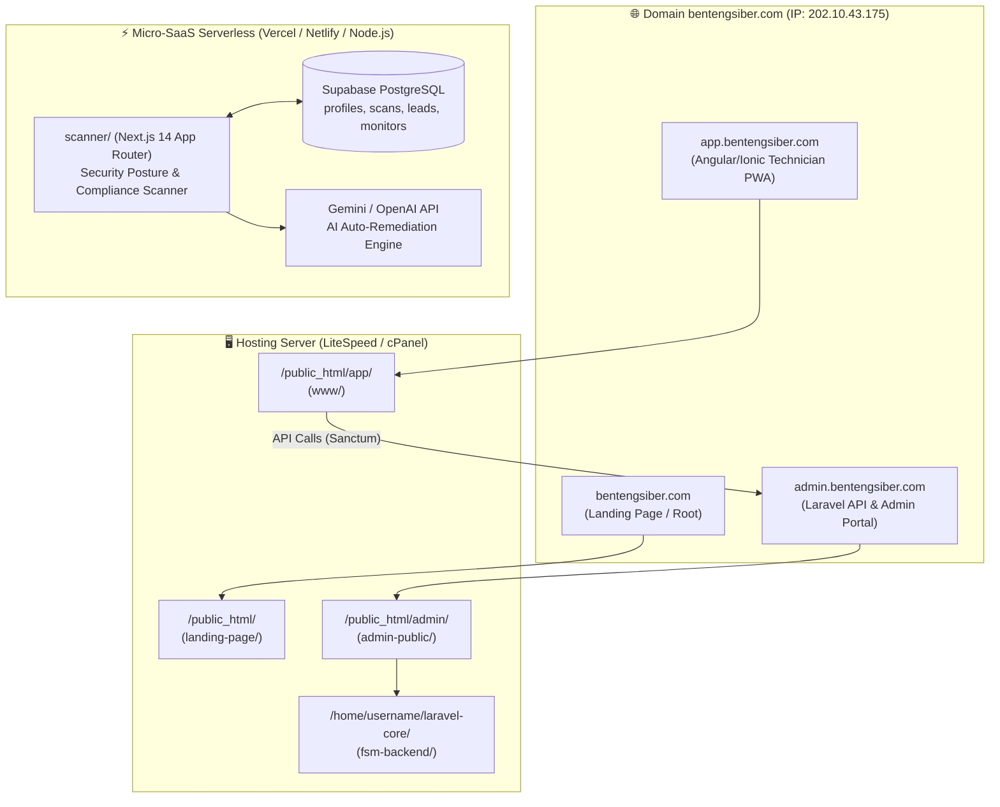

# 🛡️ BentengSiber — Cyber-Enterprise & FSM Ecosystem

Repositori monorepo hibrida yang menaungi dua ekosistem sistem terintegrasi untuk infrastruktur jaringan dan keamanan siber:

1. **Subsystem A: White-Label Security Posture & Compliance Scanner (Micro-SaaS)**
   Platform audit keamanan pasif (*100% non-intrusive*) berbasis **Next.js 14 (App Router) + TypeScript + Tailwind CSS + Supabase**. Dirancang dengan arsitektur serverless berbiaya operasional $0/bulan (*Free Tier Vercel/Netlify*), siap dijual di Flippa / Microns.io ($1,500+ valuation) lengkap dengan fitur White-Label Agency Branding, AI Auto-Remediation Snippets, dan B2B Lead Capture.
2. **Subsystem B: FiberOps Field Service Management (FSM) Portal & PWA**
   Platform operasional lapangan teknisi ISP (Internet Service Provider) berbasis **Ionic 8 + Angular 20 (PWA/Capacitor Android)** dan backend REST API berbasis **Laravel 10 + MySQL**, dilengkapi pelacakan koordinat GPS rute teknisi, validasi foto bukti kerja (*Proof-of-Work*), dan Dispatcher Web Panel.

---

## 🌐 Topologi Jaringan & Pemetaan Domain Produksi

Repositori ini terhubung dan aktif melayani domain publik **`bentengsiber.com`** pada IP Server **`202.10.43.175`**:



### Matriks Port & URL (Localhost vs Produksi)

| Layanan / Modul | URL Produksi (Live) | URL Lokal (Dev) | Port Lokal | Basis Teknologi |
| :--- | :--- | :--- | :--- | :--- |
| **Landing Page** | `https://bentengsiber.com` | `http://localhost:8000` (atau static) | - | HTML5 / Tailwind |
| **FSM Admin & REST API** | `https://admin.bentengsiber.com` | `http://127.0.0.1:8000` | `8000` | Laravel 10 (PHP 8.1+) |
| **FSM Technician PWA** | `https://app.bentengsiber.com` | `http://127.0.0.1:8100` | `8100` | Ionic 8 / Angular 20 |
| **Cyber Scanner Micro-SaaS**| `https://scanner.bentengsiber.com` | `http://localhost:3000` | `3000` | Next.js 14 / TypeScript |
| **Database FSM (MySQL)** | MySQL Shared Server | `127.0.0.1:3307` (XAMPP) | `3307` | MariaDB / MySQL 8.0 |
| **Database Scanner** | Supabase Cloud | Supabase / Local Mock | `5432` | PostgreSQL |

---

## 📂 Peta Struktur Direktori (Monorepo Blueprint)

```plaintext
reProject_bentengsiber/
├── .agents/                      # Konfigurasi AI Agent & guardrails
│   └── rules/                    # Aturan lingkungan (Graphify, workspace specs)
├── admin-public/                 # Bootstrap file Laravel public khusus cPanel LiteSpeed
├── android/                      # Proyek native Android (Capacitor) untuk build APK/AAB
├── assets/                       # Aset ikon dan splash screen perangkat mobile
├── docs/                         # Spesifikasi OpenAPI (openapi.json) & diagram alur
├── fsm-backend/                  # [Subsystem B] Backend Laravel 10 & Admin Panel
│   ├── app/                      # Controllers, Models, Middleware, Providers
│   ├── config/                   # Konfigurasi database, auth Sanctum, cors, logging
│   ├── database/                 # Migrations & Rich Data Seeder (Mock GPS rute teknisi)
│   ├── routes/                   # api.php (REST endpoints) & web.php (Admin routes)
│   └── composer.json             # Dependensi PHP backend
├── graphify-out/                 # Knowledge Graph AST codebase (1,100+ nodes, 130+ communities)
├── landing-page/                 # Web landing page statis bentengsiber.com
├── scanner/                      # [Subsystem A] White-Label Cyber Security Scanner Micro-SaaS
│   ├── src/
│   │   ├── app/
│   │   │   ├── page.tsx          # Public Landing Page & Live Scanner UI
│   │   │   ├── layout.tsx        # Cyber-Enterprise Dark Mode Layout
│   │   │   ├── report/[scanId]/  # Shareable Executive Security Report Page
│   │   │   ├── dashboard/        # B2B Agency Dashboard, Leads & Domain Monitors
│   │   │   │   └── branding/     # White-Label Agency Branding Settings (Live Preview)
│   │   │   └── api/
│   │   │       ├── scan/route.ts # Parallel Multi-Module Scanner Engine
│   │   │       └── ai-remediation/ # AI Fix Code Generator (Nginx, Apache, CF, Next.js)
│   │   ├── config/
│   │   │   └── site.ts           # 1-Click Rebranding Central Config
│   │   └── lib/
│   │       ├── types.ts          # Core TypeScript Interfaces & Scoring Types
│   │       ├── scoring.ts        # Automated Weighted Scoring & Grading Logic
│   │       ├── supabase.ts       # Supabase Client & Graceful Fallback Layer
│   │       └── scanners/         # 6 Modul Passive Inspection (Pure Node.js)
│   │           ├── headers.ts    # Module 1: HTTP Security Headers
│   │           ├── ssl.ts        # Module 2: TLS Certificate Inspector
│   │           ├── dns-email.ts  # Module 3: SPF, DMARC, MX, CAA Defense
│   │           ├── subdomains.ts # Module 4: crt.sh Passive Recon
│   │           └── compliance.ts # Modules 5 & 6: Fingerprinting & RFC 9116
│   ├── supabase/
│   │   └── schema.sql            # 4-Table Supabase PostgreSQL Schema
│   └── package.json              # Dependensi Next.js 14, Tailwind, Lucide
├── src/                          # [Subsystem B] Frontend PWA Ionic 8 / Angular 20
│   ├── app/
│   │   ├── pages/                # login, task-list, task-detail, map, history, profile
│   │   ├── services/             # api.service, auth.service, http-error.interceptor
│   │   └── guards/               # AuthGuard & AdminGuard
│   └── environments/             # environment.ts & environment.prod.ts
├── www/                          # Hasil kompilasi web frontend PWA untuk deploy
└── README.md                     # Dokumentasi komprehensif sistem
```

---

## 🚀 SUBSYSTEM A: White-Label Security Posture & Compliance Scanner

Platform Micro-SaaS B2B yang dirancang untuk agensi keamanan siber dan Managed Service Providers (MSP). Menggunakan metode **100% Passive & Non-Intrusive Inspection**, pemindaian sebuah domain hanya membutuhkan waktu **3–6 detik** tanpa memicu IP blacklist dan tanpa membutuhkan binary VPS mahal.

### 1. Enam Modul Pemindaian Inti (Parallel Execution)

Seluruh modul berjalan secara simultan menggunakan `Promise.allSettled` di [`/api/scan`](file:///c:/Users/LEO%20SYAFIQ/OneDrive/Documents/reProject_bentengsiber/scanner/src/app/api/scan/route.ts):

| No | Modul Pemeriksaan | Mekanisme Teknis (Node.js Serverless) | Indikator Skor & Penalti |
| :---: | :--- | :--- | :--- |
| **1** | **HTTP Security Headers Audit** | Melakukan HEAD/GET request ke URL target untuk mengekstrak response headers. | Cek Strict-Transport-Security (HSTS), Content-Security-Policy (CSP), X-Frame-Options, X-Content-Type-Options, Referrer-Policy, dan Permissions-Policy. |
| **2** | **SSL/TLS & Cryptographic Posture** | Native `tls.connect()` ke port 443 untuk membaca metadata sertifikat X.509 mentah. | Validitas sertifikat, countdown hari kedaluwarsa, CA Issuer, versi protokol (TLS 1.2 / 1.3), dan cipher suites. |
| **3** | **Email Spoofing & DNS Defense** | Modul `dns.promises.resolveTxt()` dan `resolveMx()` pada apex domain dan `_dmarc`. | Sintaks SPF (`-all` vs `~all`), kebijakan DMARC (`reject`, `quarantine`, `none`), MX records, dan DNS CAA records. |
| **4** | **Passive Subdomain Recon** | Query Certificate Transparency (CT) Logs via API publik `crt.sh`. | Menemukan subdomain yang pernah diterbitkan sertifikatnya tanpa brute force port. |
| **5** | **Server Leakage Fingerprinting** | Inspeksi response header dan meta tags HTML utama. | Mendeteksi kebocoran versi pada header `Server`, `X-Powered-By`, atau `X-AspNet-Version`. |
| **6** | **GDPR & Compliance Readiness** | Audit file standar industri dan atribut sesi. | Cek RFC 9116 `/.well-known/security.txt`, cookie flags (`Secure`, `HttpOnly`), dan link Kebijakan Privasi. |

### 2. Algoritma Penilaian Otomatis (Automated Scoring System)

Menggunakan sistem penalti berbasis bobot risiko mulai dari skor awal 100 poin:
* 🟢 **Grade A (90 – 100)**: *Enterprise Ready / Low Risk* (Emerald)
* 🔵 **Grade B (75 – 89)**: *Moderate Posture* (Cyan)
* 🟡 **Grade C (50 – 74)**: *Vulnerable to Misconfiguration / Spoofing* (Amber)
* 🔴 **Grade D / F (< 50)**: *Critical Exposure* (Crimson)

### 3. Tiga Fitur Komersial Pengerek Valuasi ($1,500+ Value Drivers)

1. **White-Label Agency Branding Portal** ([`/dashboard/branding`](http://localhost:3000/dashboard/branding))
   * Agensi MSP dapat mengkustomisasi nama agensi, domain website, URL logo, warna aksen Hex, dan footer laporan PDF ("*Prepared exclusively by...*").
   * Dilengkapi fitur **Interactive Live Preview** yang langsung merefleksikan kartu laporan agensi secara instan.
2. **AI Auto-Remediation Generator** ([`/api/ai-remediation`](http://localhost:3000/api/ai-remediation))
   * Di setiap kartu temuan (misal: *Missing CSP* atau *Missing HSTS*), tersedia tombol **"Generate Fix Code"**.
   * Menghasilkan konfigurasi siap pakai (Copy-Paste) untuk **Nginx**, **Apache**, **Cloudflare Workers**, dan **Next.js** (`next.config.js`). Dilengkapi opsi integrasi Gemini API Key untuk kustomisasi lanjutan.
3. **B2B Lead Capture Engine & Dashboard** ([`/dashboard`](http://localhost:3000/dashboard))
   * Pada pemindai publik, pengunjung wajib mengisi *Work Email* & *Company Name* untuk membuka detail lengkap dan download PDF.
   * Lead yang masuk otomatis tersimpan di Supabase dan dapat diunduh dalam format **Export CSV** untuk prospek penjualan agensi.

### 4. Skema Database Supabase PostgreSQL

Tersedia di [`scanner/supabase/schema.sql`](file:///c:/Users/LEO%20SYAFIQ/OneDrive/Documents/reProject_bentengsiber/scanner/supabase/schema.sql):

```sql
-- 1. Profil Agensi & Pengaturan White-Label
CREATE TABLE profiles (
  id UUID REFERENCES auth.users PRIMARY KEY,
  agency_name TEXT DEFAULT 'BentengSiber Security',
  agency_logo_url TEXT,
  primary_color TEXT DEFAULT '#10B981',
  subscription_tier TEXT DEFAULT 'agency',
  created_at TIMESTAMPTZ DEFAULT NOW()
);

-- 2. Riwayat Hasil Pemindaian (Scans)
CREATE TABLE scans (
  id UUID DEFAULT gen_random_uuid() PRIMARY KEY,
  user_id UUID REFERENCES profiles(id) ON DELETE SET NULL,
  target_domain TEXT NOT NULL,
  overall_score INT NOT NULL,
  grade VARCHAR(2) NOT NULL,
  headers_result JSONB,
  ssl_result JSONB,
  dns_result JSONB,
  subdomains_result JSONB,
  compliance_result JSONB,
  created_at TIMESTAMPTZ DEFAULT NOW()
);

-- 3. Database Leads (Tangkapan dari Public Scanner)
CREATE TABLE captured_leads (
  id UUID DEFAULT gen_random_uuid() PRIMARY KEY,
  scan_id UUID REFERENCES scans(id) ON DELETE CASCADE,
  work_email TEXT NOT NULL,
  company_name TEXT,
  target_domain TEXT NOT NULL,
  created_at TIMESTAMPTZ DEFAULT NOW()
);

-- 4. Domain Monitoring (Pemantauan Berkala)
CREATE TABLE monitored_domains (
  id UUID DEFAULT gen_random_uuid() PRIMARY KEY,
  user_id UUID REFERENCES profiles(id) ON DELETE CASCADE,
  domain TEXT NOT NULL,
  last_score INT,
  alert_email TEXT,
  is_active BOOLEAN DEFAULT true
);
```

### 5. Panduan 1-Click Rebrand

Pembeli SaaS dapat mengubah seluruh identitas brand hanya dari satu file di [`scanner/src/config/site.ts`](file:///c:/Users/LEO%20SYAFIQ/OneDrive/Documents/reProject_bentengsiber/scanner/src/config/site.ts):

```typescript
export const siteConfig = {
  name: "Apex Cyber Defense",
  description: "Enterprise Security Posture & Compliance Scanner",
  url: "https://yourbrand.com",
  brandColor: "#10B981", // Hex warna tema
  defaultAgency: {
    name: "Apex Cyber Defense LLC",
    website: "https://yourbrand.com",
    footerText: "Prepared exclusively by Apex Cyber Defense LLC, Austin, TX"
  }
};
```

---

## 📱 SUBSYSTEM B: FiberOps Field Service Management (FSM)

Sistem operasional lapangan ISP yang mengelola alur kerja tiket gangguan, pelacakan koordinat teknisi secara real-time, dan verifikasi dokumentasi perbaikan fisik kabel optik.

### 1. Fitur Utama Sistem FSM
1. **Pemberian & Pemantauan Tugas (Task Assignment)**: Distribusi tiket gangguan (Redaman Tinggi, LOS, Instalasi Baru, Migrasi Bandwidth) dari dispatcher ke teknisi.
2. **Pemantauan Koordinat GPS**: Melacak rute perjalanan teknisi secara real-time berdasarkan koordinat geografis (terintegrasi mock seeder rute Monas, SCBD, Manggarai, Palmerah).
3. **Dokumentasi Bukti Kerja (Proof of Work)**: Teknisi mengunggah dokumentasi foto (kondisi *before* & *after*) serta catatan progres sebelum tiket dapat dinyatakan selesai.
4. **Dispatcher Web Dashboard**: Panel admin Laravel untuk mengelola penugasan teknisi, memonitor status tiket, dan melihat peta posisi teknisi.
5. **Offline Capability**: Progressive Web App (PWA) dengan local storage caching yang memungkinkan akses tugas di area bersinyal lemah.

### 2. Ringkasan Perbaikan Presisi & Keamanan (Surgical Patches Applied)

Codebase telah diaudit dan diperbaiki secara menyeluruh:

* **Pencegahan Celah IDOR (Insecure Direct Object Reference)**:
  * [`TaskController.php`](file:///c:/Users/LEO%20SYAFIQ/OneDrive/Documents/reProject_bentengsiber/fsm-backend/app/Http/Controllers/Api/TaskController.php): Membatasi teknisi hanya bisa melihat dan memproses tugas miliknya sendiri (`403 Forbidden` jika mengakses tugas teknisi lain).
  * [`ProofController.php`](file:///c:/Users/LEO%20SYAFIQ/OneDrive/Documents/reProject_bentengsiber/fsm-backend/app/Http/Controllers/Api/ProofController.php): Memvalidasi kepemilikan data bukti kerja sebelum diizinkan diakses.
* **Integritas Alur Kerja (Workflow Integrity)**:
  * [`TaskController.php`](file:///c:/Users/LEO%20SYAFIQ/OneDrive/Documents/reProject_bentengsiber/fsm-backend/app/Http/Controllers/Api/TaskController.php#L85-L95): Mewajibkan minimal 1 dokumentasi Proof-of-Work sebelum status tugas diizinkan berubah menjadi `completed` (`422 Unprocessable Entity` jika bukti foto kosong).
* **Proteksi Brute-Force & Mass Assignment**:
  * [`routes/api.php`](file:///c:/Users/LEO%20SYAFIQ/OneDrive/Documents/reProject_bentengsiber/fsm-backend/routes/api.php): Menambahkan middleware `throttle:5,1` pada endpoint login.
  * [`Admin/TaskController.php`](file:///c:/Users/LEO%20SYAFIQ/OneDrive/Documents/reProject_bentengsiber/fsm-backend/app/Http/Controllers/Api/Admin/TaskController.php): Menghapus `$request->all()` dan menggantinya dengan validasi *whitelist fields*.
* **Optimasi Performa & Memory Leak**:
  * [`Task.php`](file:///c:/Users/LEO%20SYAFIQ/OneDrive/Documents/reProject_bentengsiber/fsm-backend/app/Models/Task.php): Mengeliminasi N+1 Query pada accessor `getProgressPercentAttribute()` menggunakan pengecekan `relationLoaded()`.
  * [`map.page.ts`](file:///c:/Users/LEO%20SYAFIQ/OneDrive/Documents/reProject_bentengsiber/src/app/pages/map/map.page.ts): Mengikat interval update GPS Geolocation dengan lifecycle hook Ionic (`ionViewWillEnter` / `ionViewDidLeave`) untuk mencegah kebocoran memori di background.
  * [`task-list.page.html`](file:///c:/Users/LEO%20SYAFIQ/OneDrive/Documents/reProject_bentengsiber/src/app/pages/task-list/task-list.page.html): Menerapkan `trackBy: trackByTaskId` pada render list Angular.

---

## 📡 Daftar Endpoint REST API (FSM Backend)

Seluruh endpoint terproteksi memerlukan Header otentikasi Bearer Token (`Authorization: Bearer <token_key>`).

### 🔓 Endpoint Publik
* `POST /api/login` -> Autentikasi user dan mengembalikan token Sanctum (*rate limited: 5 req/min*).

### 🔒 Endpoint Teknisi (Role: Technician)
* `POST /api/logout` -> Menghapus sesi token aktif.
* `GET /api/me` -> Mengambil profil pengguna yang sedang login.
* `PUT /api/profile` -> Memperbarui informasi profil.
* `GET /api/tasks` -> Melihat daftar tugas aktif teknisi.
* `GET /api/tasks/history` -> Melihat riwayat tugas yang telah selesai.
* `GET /api/tasks/{task}` -> Mengambil detail spesifik tugas (*terproteksi IDOR*).
* `POST /api/tasks/{task}/accept` -> Mengubah status menjadi `accepted`.
* `POST /api/tasks/{task}/reject` -> Menolak penugasan dengan alasan tertulis.
* `POST /api/tasks/{task}/start` -> Memulai pengerjaan (`in_progress`).
* `POST /api/tasks/{task}/complete` -> Menyelesaikan tugas (*wajib menyertakan bukti foto*).
* `POST /api/tasks/{task}/progress` -> Menambahkan catatan progres tugas.
* `POST /api/location` -> Mengirimkan koordinat GPS teknisi ke server.
* `GET /api/tasks/{task}/proof` -> Mengambil berkas bukti pengerjaan.
* `POST /api/tasks/{task}/proof` -> Mengunggah foto dokumentasi lapangan (before/after).

### 🔒 Endpoint Administrasi (Role: Admin / Dispatcher)
* `GET /api/admin/dashboard` -> Ringkasan statistik operasional dan pemetaan teknisi.
* `GET /api/admin/tasks` -> Melihat daftar seluruh tugas di sistem.
* `POST /api/admin/tasks` -> Membuat lembar tugas baru.
* `GET /api/admin/tasks/{task}` -> Detail tugas dari sudut pandang dispatcher.
* `PUT /api/admin/tasks/{task}` -> Memperbarui data tugas (*whitelisted fields*).
* `POST /api/admin/tasks/{task}/assign` -> Menugaskan tugas ke teknisi tertentu.
* `GET /api/admin/technicians` -> Mengambil daftar seluruh teknisi lapangan.
* `POST /api/admin/technicians` -> Mendaftarkan akun teknisi baru.
* `PUT /api/admin/technicians/{user}` -> Memperbarui data teknisi.
* `DELETE /api/admin/technicians/{user}` -> Menonaktifkan/menghapus akun teknisi.

---

## 🔑 Kredensial Uji Coba Default (Demo Accounts)

Password global untuk seluruh akun demo: **`password123`**

| Role | Akun Email | Akses Platform |
| :--- | :--- | :--- |
| **Dispatcher / Admin** | `admin@fsm.com` | Web Admin Portal (`admin.bentengsiber.com`) |
| **Teknisi Lapangan 1** | `alex@fsm.com` | Aplikasi Mobile / PWA (`app.bentengsiber.com`) |
| **Teknisi Lapangan 2** | `budi@fsm.com` | Aplikasi Mobile / PWA |
| **Teknisi Lapangan 3** | `citra@fsm.com` | Aplikasi Mobile / PWA |
| **Teknisi Lapangan 4** | `dedi@fsm.com` | Aplikasi Mobile / PWA |
| **Teknisi Lapangan 5** | `eka@fsm.com` | Aplikasi Mobile / PWA |

---

## 💻 Panduan Menjalankan Proyek Secara Lokal (Local Development)

### 1. Menjalankan Database MySQL (Port 3307)
Pastikan instance MySQL lokal Anda berjalan pada port **`3307`** (sesuai konfigurasi XAMPP):
```powershell
& "C:\Users\LEO SYAFIQ\OneDrive\Documents\xampp2\mysql\bin\mysqld.exe" --defaults-file="C:\Users\LEO SYAFIQ\OneDrive\Documents\xampp2\mysql\bin\my.ini" --standalone
```

### 2. Menjalankan FSM Backend (Laravel 10)
```powershell
cd fsm-backend
# Salin konfigurasi environment jika belum ada
copy .env.example .env
# Jalankan composer install menggunakan binary wrapper
composer install
php artisan key:generate
php artisan migrate:fresh --seed
php artisan storage:link
php artisan serve --host=127.0.0.1 --port=8000
```
Backend akan aktif di `http://127.0.0.1:8000`.

### 3. Menjalankan FSM Frontend (Ionic 8 / Angular 20)
```powershell
# Dari direktori root proyek
npm install
npx ng serve --port 8100 --host 127.0.0.1
```
Aplikasi PWA akan aktif di `http://127.0.0.1:8100`.

### 4. Menjalankan Cyber Security Scanner (Next.js 14)
```powershell
cd scanner
npm install
npm run dev
# Atau untuk mode production:
# npm run build
# npm run start
```
Pemindai Micro-SaaS akan aktif di `http://localhost:3000`.

---

## 🌐 Panduan Deployment Produksi

### A. Deploy Cyber Scanner ke Vercel / Netlify ($0/Bulan)
1. Buat repository baru di GitHub untuk folder `scanner/`.
2. Buka [Vercel](https://vercel.com) dan impor repository tersebut.
3. Tambahkan Environment Variables di dashboard Vercel:
   ```env
   NEXT_PUBLIC_SUPABASE_URL=https://your-project.supabase.co
   NEXT_PUBLIC_SUPABASE_ANON_KEY=your-anon-key
   GEMINI_API_KEY=your-optional-gemini-key
   ```
4. Klik **Deploy**. Scanner langsung live dengan infrastruktur Edge / Serverless global.

### B. Deploy FSM ke cPanel Shared Hosting (LiteSpeed)
1. **Subdomain Setup**:
   * `admin.bentengsiber.com` -> folder `/public_html/admin/`
   * `app.bentengsiber.com` -> folder `/public_html/app/`
2. **Laravel Core**:
   * Letakkan folder `fsm-backend/` di `/home/username/laravel-core/` (di luar webroot agar aman).
   * Isi folder `admin-public/` diekstrak ke `/public_html/admin/`.
   * Ekstrak hasil build PWA frontend (`www/`) ke `/public_html/app/`.
3. **Solusi Driver PDO LiteSpeed (`Class "PDO" not found`)**:
   Jika administrator hosting menonaktifkan CageFS / Site Isolation, tambahkan `php.ini` di `/public_html/admin/`:
   ```ini
   extension=/opt/alt/php81/usr/lib64/php/modules/pdo.so
   extension=/opt/alt/php81/usr/lib64/php/modules/pdo_mysql.so
   extension=/opt/alt/php81/usr/lib64/php/modules/mbstring.so
   extension=/opt/alt/php81/usr/lib64/php/modules/fileinfo.so
   ```
   Lalu tambahkan instruksi ini pada baris paling atas `/public_html/admin/.htaccess`:
   ```apache
   SetEnv PHPRC /home/username/public_html/admin
   LSPHP_ConfigPath /home/username/public_html/admin
   ```

---

## 📄 Lisensi & Hak Cipta
Hak Cipta © 2026 BentengSiber Defense Ecosystem. Seluruh hak cipta dilindungi undang-undang.
